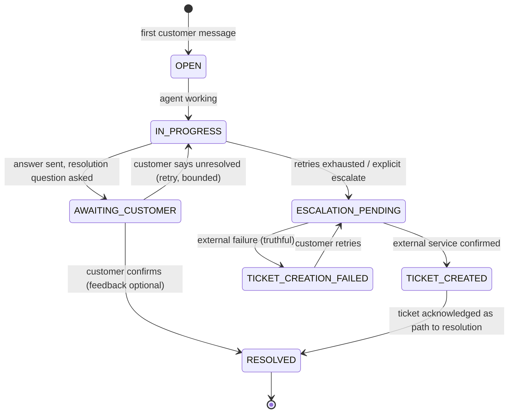
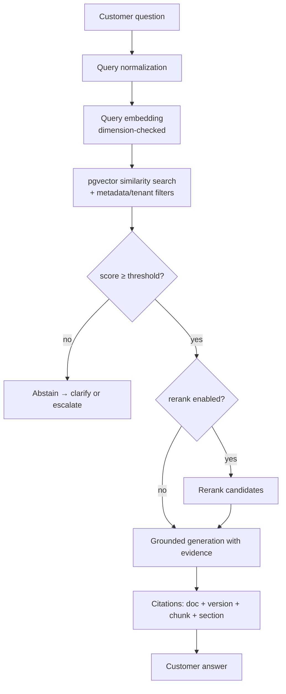

# Architecture — E-commerce AI Support Assistant

| Field | Value |
| --- | --- |
| Version | 1.0 |
| Date | 2026-10-16 |
| Status | Draft — pending consistency review (TASK-004 gate) |

## 1. System context

```mermaid
flowchart LR
    Customer[Customer / Web Chat] -->|POST /api/v1/chat (SSE)| API[FastAPI API Layer]
    API -->|guardrails + auth| Orchestrator[SuperAgent / Router<br/>LangGraph]
    Orchestrator --> OA[Order Agent]
    Orchestrator --> PA[Product Agent]
    Orchestrator --> RA[Policy RAG Agent]
    Orchestrator --> AA[Account Agent]
    Orchestrator --> ResA[Resolution Agent]
    Orchestrator --> EscA[Escalation Agent]
    OA --> CA[Commerce Adapter<br/>mock / Magento later]
    PA --> CA
    AA --> CA
    RA --> RAG[RAG Pipeline]
    RAG --> DB[(PostgreSQL 16<br/>+ pgvector)]
    EscA --> TICK[Ticketing Adapter<br/>Jira / ServiceNow / mock]
    FB[Feedback Worker] --> DB
    API --> DB
    LLM[LLM Provider Layer<br/>Claude · OpenAI · Gemini · Ollama · compatible] --- Orchestrator
    LLM --- RAG
    LLM --- CA
```

## 2. Component responsibilities

| Component | Location | Responsibility | Explicitly NOT responsible for |
| --- | --- | --- | --- |
| API layer | `api/` | HTTP contracts, auth, validation, rate limits, SSE, correlation IDs | Business decisions, direct DB schema access beyond repositories |
| Core config/logging | `core/` | Validated settings (YAML+env), structured logging, exceptions, trace IDs | Framework-specific logic |
| Schemas | `schemas/` | Pydantic v2 contracts shared by API, agents, tools | Persistence mapping |
| LLM layer | `llm/` | Provider-independent interface, factory, capabilities, retries, usage | Prompt content, business rules |
| Router / graph | `agents/` | Intent classification, routing, workflow state, bounded execution | Data fetching (delegates to workers/tools) |
| Workers | `agents/workers/` | Domain logic per area with typed I/O and limited tool permissions | Orchestration, direct SQL |
| RAG | `rag/` | Load, normalize, chunk, embed, store, retrieve, rerank, cite, abstain, evaluate | Commerce data, ticketing |
| Tools | `tools/` | Typed, permission-checked, audited operations for workers | Authorization policy definition (delegates to `guardrails/`) |
| Guardrails | `guardrails/` | Input/output validation, authz checks, injection defense, PII handling | Domain answers |
| Integrations | `integrations/` | Commerce + ticketing adapters (interface, mock, real) | Agent behavior |
| DB | `db/` | SQLAlchemy models, session, repositories | API serialization |
| Services | `services/` | Chat/conversation/feedback/escalation/streaming use-cases | Framework glue |
| Workflows | `workflows/` | Resolution state machine, ticket lifecycle + idempotency | UI |
| Scripts | `scripts/` | Ingest, seed, evaluate | Runtime request path |

## 3. Chat request workflow

```mermaid
sequenceDiagram
    participant C as Client
    participant API as FastAPI
    participant G as Guardrails
    participant R as Router (LangGraph)
    participant W as Worker
    participant T as Tools/Integrations
    participant DB as PostgreSQL
    participant L as LLM Provider

    C->>API: POST /api/v1/chat (message, conversation_id?, auth?)
    API->>G: validate schema, auth, rate limit, injection scan
    G-->>API: ok / reject
    API->>DB: load or create conversation + user message
    API->>R: invoke graph (streaming)
    R->>R: classify intent (deterministic → LLM fallback)
    R->>W: dispatch to worker with typed state
    W->>T: tool call(s) (registry validation + ownership check + audit)
    T->>DB: persist tool_execution record
    T-->>W: typed result
    W->>L: generate answer (grounded; RAG evidence if policy)
    L-->>W: streamed tokens
    W-->>R: worker result + evidence
    R->>R: Resolution Agent: ask "resolved?" state
    API-->>C: SSE: message_start, token*, source*, tool_*, message_end
    API->>DB: persist assistant message + status
    C->>API: resolve? / feedback / more help (subsequent turns)
```

## 4. Resolution and escalation state machine



Rules:
- Transitions are requested by agents but validated centrally (`workflows/resolution.py`,
  `workflows/ticket_lifecycle.py`); illegal transitions raise `InvalidStateTransition`.
- Retries are bounded (default max 2 alternative attempts per conversation turn-set).
- `TICKET_CREATED` is emitted to the customer **only** after the ticketing adapter confirms
  creation; otherwise the system reports failure honestly.

## 5. RAG pipeline flow



Ingestion flow: upload → type/size validation → text extraction → normalization →
configurable chunking → content-hash dedupe → embedding → pgvector store with document
version + ingestion status.

## 6. Streaming event model (SSE)

Envelope: `{event: <type>, request_id, conversation_id, data: <typed payload>}`

| Event | When | Payload highlights |
| --- | --- | --- |
| `message_start` | graph begins | `message_id`, `agent` |
| `token` | provider streaming | `text` delta (customer-visible only) |
| `tool_start` | tool invoked | `tool_name`, `call_id` (no raw args if sensitive) |
| `tool_result` | tool finished | `call_id`, `summary` (redacted) |
| `source` | RAG evidence included | `document`, `section`, `score` |
| `ticket_created` | external confirmation | `ticket_id`, `url`, `provider`, `status` |
| `error` | any failure after stream start | `code`, `message` (safe text) |
| `message_end` | terminal | `status`, `usage`, `resolution_state` |

## 7. Key decisions (ADR summary)

| # | Decision | Rationale | Alternatives rejected |
| --- | --- | --- | --- |
| D-001 | LangGraph for orchestration, plain Python for business logic | Durable state machine + testable core | All-in framework (harder to test), ad-hoc if/else spaghetti |
| D-002 | Provider-independent LLM interface with capability matrix | Swap Claude↔OpenAI↔Gemini↔Ollama by config only | Direct SDK calls in agents |
| D-003 | PostgreSQL + pgvector for relational + vector | One store, transactions, familiar ops | Separate vector DB (operational cost) |
| D-004 | Mock-first commerce/ticketing/LLM | Full CI without credentials; demoable | Live-only integrations (untestable) |
| D-005 | Pydantic contracts everywhere; authz in code not prompts | Security cannot live in prompts | Prompt-only guardrails |
| D-006 | SSE typed lifecycle events | Simple, debuggable streaming for web chat | WebSockets (heavier, unnecessary for one-way stream) |
| D-007 | Config = YAML (structure) + env (secrets/overrides), Pydantic-validated | Reviewable defaults, secret-safe | Hardcoded, dotenv-only |
| D-008 | Idempotency keys for ticket creation | Prevents duplicate tickets on retry | Trust-at-most-once |
| D-009 | JWT auth (HS256) pluggable to IdP | Simple v1, replaceable | Vendor IdP lock-in |
| D-010 | RAG abstention below threshold | Grounded answers beat confident wrong ones | Always-answer |
| D-011 | Host DB port 5434, container `ecom-bot-pg` | Coexists with `myexam-pg` on 5433 | Reuse shared DB (coupling) |
| D-012 | Pin deps + commit lockfile | Reproducible builds | Floating ranges |
| D-013 | Read-only v1: no refunds/cancellations/account mutations | Safety; escalation covers high-impact actions | Agent-executed mutations |
| D-014 | Docker Compose with `docker compose` v2 (fallback to legacy v1) | Legacy `docker-compose` 1.29.2 is broken by urllib3 v2 in this environment; v2 plugin installed via `~/.docker/cli-plugins` | v2-only syntax with no fallback |

## 8. Major dependencies (baseline, pinned at TASK-005)

| Area | Package | Notes |
| --- | --- | --- |
| API | `fastapi`, `uvicorn[standard]` | SSE via StreamingResponse |
| Validation | `pydantic>=2.9,<3` | Contracts + settings |
| ORM/migrations | `sqlalchemy[asyncio]`, `alembic`, `pgvector`, `asyncpg` | Async session; vector store |
| Agents | `langgraph`, `langchain-core` | Graph + message abstractions |
| Providers | `langchain-anthropic`, `langchain-openai`, `langchain-google-genai` | Behind own interface, not agent code |
| HTTP | `httpx` | Adapter calls, retries |
| Config | `pyyaml`, `python-dotenv` | YAML + env layering |
| Logging | `structlog` (or stdlib JSON) | Trace-ID correlation |
| Auth | `pyjwt` (or `python-jose`) | JWT HS256 |
| Tests | `pytest`, `pytest-asyncio`, `pytest-cov`, `aiosqlite` | Mock-first |
| Quality | `ruff`, `mypy` | Lint/format/typecheck |
| Documents | `pypdf`, `beautifulsoup4` | PDF/HTML extraction (TASK-016) |

## 9. Data model (summary)

Tables: `users`, `conversations`, `messages`, `orders`, `order_items`, `products`,
`policy_documents`, `document_chunks` (vector), `feedback`, `support_tickets`,
`tool_executions`, `audit_events`, `eval_results`. Full schema in `docs/database-schema.md`
(Task-010 deliverable); keys, constraints, indexes, timestamps, and lifecycle statuses per
`requirement.md` §7.

## 10. Security architecture (layered)

1. **API middleware**: schema validation, size limits, rate limit, correlation ID.
2. **AuthN/AuthZ**: JWT verify → customer scope; admin scope for ingest/eval.
3. **Graph entry**: prompt-injection scan, PII detection, intent allowlist.
4. **Tool/service**: ownership checks, parameter validation, least-privilege allowlist,
   idempotency, audit event.
5. **Output**: secret/PII leakage filter, policy grounding check, high-impact action block.
6. **Audit**: every sensitive access logged without secrets/full PII.
