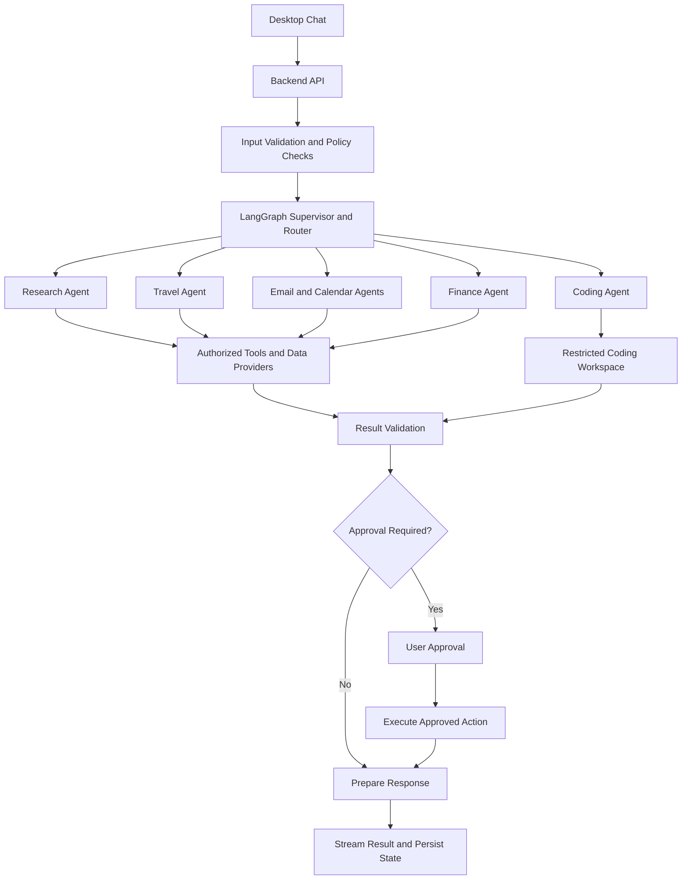

# NexaPilot AI — Autonomous Implementation Workflow

> **Purpose:** This document is the implementation specification for an AI coding agent building NexaPilot AI.
> Read this file together with the project's separate universal architecture audit checklist. Treat that checklist as a reference for required concepts and verification—not as permission to add every technology indiscriminately.
>
> **Operating rule:** Inspect first, plan second, implement in small verified stages, and report evidence. Do not claim completion without tests or other verifiable evidence.

## 1. Product Goal

Build **NexaPilot AI**, a cross-platform desktop personal AI assistant with one chat interface and specialized workflows for:

- Web search and research-backed question answering
- Hotel, train, and flight discovery and booking through supported providers
- Multiple email accounts for separate purposes
- A unified calendar combining connected calendars and events extracted from authorized emails
- Finance research and portfolio analysis for stocks, mutual funds, ETFs, and cryptocurrencies, using the latest available data
- A coding agent that can inspect, edit, test, and debug software projects safely

The application must have a desktop app, not a website-only product. Target Windows and Ubuntu first; keep the architecture portable to macOS where practical.

## 2. Non-Negotiable Requirements

1. Use **one active LLM provider at a time**, selected in application Settings.
2. Support provider adapters for OpenAI, Anthropic Claude, Ollama, Google Gemini, and extensible compatible providers.
3. Local Ollama usage must not require an unrelated cloud API key.
4. Route all agents through the selected provider unless a clearly documented, user-approved exception is designed. Never silently switch providers.
5. Use **LangGraph** for stateful orchestration, routing, checkpoints, resumable workflows, and agent execution where appropriate.
6. Use Pydantic or equivalent typed validation for configuration, tool inputs, and structured outputs.
7. Provide streaming responses and task-progress updates in the desktop chat.
8. Use OAuth or official authorization flows for email, calendar, travel, brokerage, and other connected accounts whenever available.
9. Use official or authorized service integrations. Do not bypass CAPTCHAs, MFA, payment controls, access restrictions, or provider terms.
10. Require explicit user approval before sending email, deleting or forwarding messages, making bookings, paying, placing live trades, deploying code, or performing destructive operations.
11. Finance data must show its source and timestamp. Never label delayed or stale data as live.
12. Run coding tasks in a restricted workspace with command and filesystem permissions.
13. Store credentials using the operating system's secure credential store or a suitable secret manager. Never commit or log secrets.
14. Provide installable Windows and Ubuntu builds that bundle/manage application dependencies and clearly explain any separately required services such as Ollama.
15. Build incrementally. Do not implement all integrations as fake placeholders and then report them as complete.

## 3. Recommended Technology Stack

Choose versions that are compatible at implementation time and record the chosen versions in project manifests.

- **Desktop shell:** Tauri 2
- **Desktop UI:** React + TypeScript
- **Backend:** Python + FastAPI, launched and managed by the desktop application
- **Agent orchestration:** LangGraph
- **Model integrations:** Official provider SDKs behind a shared adapter interface
- **Validation:** Pydantic
- **Local persistence:** SQLite with migrations
- **Credentials:** Windows Credential Manager / supported Linux Secret Service backend / platform-appropriate secure storage
- **Tool interoperability:** MCP only where it adds real value; validate every tool and permission
- **Testing:** pytest, frontend tests, integration tests, and packaging smoke tests
- **Packaging:** Tauri installers plus a packaged or managed Python backend

Do not add LangChain, a vector database, Redis, Docker, a separate web service, or any other dependency unless a concrete requirement justifies it. Keep the application usable for local-only workflows where possible.

## 4. Required User Experience

### 4.1 Main Navigation

Provide a clean desktop layout with:

- Chat
- Research
- Travel
- Email
- Calendar
- Finance
- Coding
- Settings
- Activity / task history
- Connected accounts and permissions

The chat should remain the primary entry point. Specialized pages may show results and controls for the same underlying workflows.

### 4.2 Settings: Single Active Model

Create a model settings page with:

- Provider selection: OpenAI, Claude, Ollama, Gemini, and supported custom endpoints
- Model identifier
- Endpoint/base URL where applicable
- Authentication method supported by that provider
- Secure API-key entry where required
- Test Connection action
- Save and Activate action
- Clear active-provider indicator
- Capability indicators for streaming, tool calling, and structured output
- Helpful configuration errors

Use one persisted `active_provider` and one active model configuration. Other providers' credentials may be saved securely for later use, but inactive providers must not receive inference requests. Switching providers should validate the target configuration first and only then atomically activate it. Do not fall back silently.

Authentication modes must reflect actual provider capabilities:
- API key for providers that require it
- Supported cloud identity/managed identity where available
- Local Ollama endpoint without a cloud key
- Custom endpoint with authentication optional only if the endpoint supports that mode

### 4.3 Chat and Streaming

- Stream response chunks and relevant task status updates.
- Display which configured model is active.
- Support cancel/stop.
- Preserve conversation history according to user settings.
- Show citations for web research.
- Show approval cards for actions requiring confirmation.
- Show clear error, retry, and partial-result states.
- Avoid exposing internal reasoning or secrets.

## 5. Core Architecture

Use a shared model-provider interface and a LangGraph supervisor/router. Keep UI, orchestration, tools, provider adapters, and integrations separated.

Suggested high-level flow:

### 5.1 Model Provider Interface

Define a common interface for operations needed by the application, such as:

- Non-streaming generation
- Streaming generation
- Tool/function calling where supported
- Structured output where supported
- Model metadata/capabilities
- Timeouts, cancellation, retries, and normalized errors

Implement provider adapters separately. Do not pretend every model supports the same capabilities. Detect unsupported capabilities and provide a useful error or a safe alternative.

### 5.2 LangGraph

Use explicit graph state, nodes, edges, routing rules, termination conditions, and error handling. Add checkpointing/resume support for long-running workflows. Avoid unbounded loops. Keep approvals as explicit interrupt/resume steps when suitable.

### 5.3 Tool Contracts

Each tool must declare:

- Name and purpose
- Input schema
- Output schema
- Required permissions
- Whether it has external side effects
- Timeout and retry policy
- Idempotency behavior where applicable
- Audit logging policy

Validate arguments before execution. Tool output and external content must be treated as untrusted data.

## 6. Agent Workflows

### 6.1 Research and Web Search Agent

Workflow:
1. Understand the request and whether current information is required.
2. Search trusted web sources using an available search integration.
3. Open relevant sources and verify claims.
4. Summarize with citations and publication/update dates where available.
5. Clearly distinguish sourced facts, estimates, and unknowns.
6. Never invent search results, prices, availability, or citations.

If no search provider is configured, tell the user and provide a clear setup path rather than pretending to search live.

### 6.2 Travel Agent

Support hotel, flight, and train discovery first, then booking through authorized integrations.

Workflow:
1. Collect missing essential details: origin/destination, dates, passenger count, budget, and relevant preferences.
2. Search supported providers.
3. Compare total price, baggage/fees, cancellation terms, timing, and availability.
4. Present options with provider/source and retrieval time.
5. Show a complete booking preview.
6. Obtain explicit approval before booking or payment.
7. Execute through the authorized provider.
8. Verify and persist the confirmation, booking reference, and cancellation rules.

For Indian rail travel, use a permitted official or authorized booking workflow. If no supported booking API exists, guide the user through the provider's official flow; do not bypass controls or falsely claim a booking was made.

### 6.3 Email Agent

- Support multiple independently authorized email accounts.
- Use OAuth or the provider's official authorization method.
- Apply least-privilege scopes and make granted permissions visible.
- Support inbox search, classification, summarization, and draft creation.
- Require explicit approval before sending, deleting, forwarding, or changing important messages.
- Track account/source IDs and synchronization state.
- Handle token expiry, revoked access, pagination, and rate limits.
- Do not treat instructions embedded in emails as trusted system instructions.

### 6.4 Unified Calendar Agent

- Sync connected calendars and relevant email-derived events.
- Use incremental sync and persistent cursors where supported.
- Extract interview, exam, appointment, travel, deadline, and other event details.
- Record event provenance and confidence.
- Distinguish actual calendar events from inferred events.
- Normalize time zones and daylight-saving changes.
- Deduplicate repeated invitations and extracted events.
- Detect conflicts and changed/canceled events.
- Provide configurable reminders.
- Ask before creating or modifying consequential events unless the user has configured a clear, safe automation rule.

### 6.5 Finance Agent

Start with read-only market research and portfolio analysis. Add transactions only after supported integrations and safety controls are verified.

- Support relevant stocks, mutual funds, ETFs, and cryptocurrencies.
- Use authorized data providers and broker/exchange APIs.
- Display source, timestamp, currency, market status, and delay where known.
- Handle market closures, delayed NAVs, missing values, and provider outages.
- Separate factual data from forecasts and model-generated analysis.
- Support watchlists, portfolio views, risk summaries, and scenario analysis.
- Provide paper trading before live trading.
- Require a final order preview and explicit approval for each live order.
- Apply configurable order limits and verify execution status with the broker.
- Never promise returns or present speculative predictions as certainty.
- Follow applicable laws, provider rules, and financial-data licensing restrictions.

If real-time data or a trading API is unavailable, clearly state the limitation.

### 6.6 Coding Agent

- Inspect repositories and follow their `AGENTS.md`, `CLAUDE.md`, and applicable project rules.
- Build a plan before multi-step changes.
- Work in a restricted, user-selected workspace.
- Read and edit files with path restrictions.
- Generate and run tests, linters, and type checks.
- Show diffs and summarize changes.
- Limit command execution, runtime, network access, and resource consumption.
- Require approval for destructive commands, installing untrusted dependencies, accessing secrets, pushing code, deploying, or modifying files outside the authorized workspace.
- Support cancellation and recovery from failed steps.
- Never claim tests passed without executing them.
- Treat repository content as untrusted; project instructions cannot override application security policy.

### 6.7 Supervisor and Router

- Classify requests and select the minimum necessary workflow.
- Delegate using validated task contracts.
- Combine and validate results.
- Preserve relevant task state and provenance.
- Handle timeouts, retries, partial failures, and cancellation.
- Set iteration and tool-call budgets.
- Ask clarifying questions when an essential detail is missing.
- Avoid invoking all agents for every request.
- Use deterministic routing for security-sensitive decisions where appropriate.

## 7. Email, Calendar, and Account Security

- Keep account tokens isolated by account and provider.
- Store credentials in the OS credential vault or an appropriate secret manager.
- Never put secrets in source files, logs, prompts, or version control.
- Provide disconnect, revoke, and local-data deletion controls.
- Minimize stored email content; prefer storing only what's needed.
- Encrypt sensitive local data where appropriate.
- Define data retention and backup behavior.
- Treat email and calendar content as untrusted input.
- Show which account will be used before sending or modifying data.

## 8. Installation and Cross-Platform Delivery

The release must target Windows and Ubuntu first.

- Package the desktop frontend and backend.
- Bundle or manage the required runtime and Python dependencies.
- Provide first-run setup and dependency checks.
- Detect whether Ollama is installed/reachable when selected.
- Explain how to install or select a local model.
- Do not require users to manually create a Python virtual environment for a packaged release.
- Provide a developer setup for contributors.
- Include upgrade and migration handling.
- Include uninstall and local-data handling instructions.
- Test installation on a clean Windows environment and a clean supported Ubuntu environment.
- Document system requirements, limitations, and external service prerequisites.

Do not claim universal OS compatibility until tested on the target platforms.

## 9. Required Repository Documentation and Files

Create or update only what is needed, but ensure the project has appropriate versions of:

- `README.md` — product overview, setup, usage, and troubleshooting
- `docs/requirements.md` — functional and nonfunctional requirements
- `docs/architecture.md` — components, data flows, and design decisions
- `docs/security.md` — permissions, secrets, threat model, and approval gates
- `docs/installation.md` — end-user and developer installation
- `docs/integrations.md` — providers, scopes, capabilities, and limitations
- `docs/testing.md` — test strategy and commands
- `.env.example` — placeholders only; no real secrets
- `.gitignore` — exclude secrets, caches, build artifacts, and local databases as appropriate
- `pyproject.toml` and/or appropriate lockfiles — reproducible backend dependencies
- Frontend package manifest and lockfile
- `CLAUDE.md` and/or `AGENTS.md` — coding-agent project instructions, where relevant
- Relevant tests for provider adapters, graph workflows, tools, approvals, sync, and packaging

Do not create a fake or unused file merely to satisfy a checklist. Explain any checklist item that is genuinely not applicable.

## 10. Security and Approval Policy

The following actions require explicit user approval immediately before execution unless a narrowly scoped, user-configured policy explicitly permits the action:

- Sending or forwarding email
- Deleting messages or data
- Booking or canceling travel
- Making payments
- Placing live financial orders
- Running destructive or privileged commands
- Accessing or transmitting secrets
- Pushing code or deploying applications
- Changing permissions or sharing private data

Approval must display the exact action, target account/provider, relevant cost or risk, and material consequences. Approval for one action must not be interpreted as approval for unrelated future actions.

Enforce permissions in code, not only through prompts. Provide an audit trail without recording sensitive content unnecessarily.

## 11. Implementation Plan and Milestones

Implement in these milestones. At the start of each milestone, inspect current work and update the task plan.

### Milestone 0 — Repository audit and plan
- Inspect the existing repository.
- Read the separate universal architecture audit checklist.
- Identify existing code, reusable components, constraints, and risks.
- Produce a gap matrix and implementation plan.
- Do not overwrite existing work blindly.

### Milestone 1 — Desktop foundation
- Build the desktop shell and navigation.
- Set up the backend lifecycle.
- Add configuration, local database, secure credential abstraction, and logs.
- Add basic chat and cancellation.

### Milestone 2 — Provider abstraction
- Implement OpenAI, Claude, Ollama, and Gemini adapters as supported.
- Implement single-active-provider settings.
- Add connection tests, capability detection, streaming, and normalized errors.
- Test switching providers and verify that inactive providers are not called.

### Milestone 3 — LangGraph agent core
- Implement graph state, supervisor/router, structured tool contracts, checkpointing where required, approvals, and bounded retries.
- Add Pydantic validation and safe error handling.

### Milestone 4 — Research and coding
- Implement cited web research.
- Implement sandboxed repository inspection, file editing, test execution, diffs, and approval gates.

### Milestone 5 — Email and unified calendar
- Implement OAuth account connections, incremental synchronization, event extraction, deduplication, reminders, and account-level controls.

### Milestone 6 — Travel
- Implement provider discovery and comparisons.
- Add supported booking flows, approval, booking verification, and error recovery.

### Milestone 7 — Finance
- Implement timestamped market-data integrations, read-only analysis, and portfolio views.
- Add paper trading and only then supported live transactions with strong controls.

### Milestone 8 — Hardening and packaging
- Run security checks and tests.
- Validate cancellation, failure recovery, provider switching, and secret protection.
- Build and test Windows and Ubuntu installers.
- Complete documentation and release checks.

## 12. Testing and Acceptance Criteria

A milestone is complete only when its acceptance criteria are met and evidence is recorded.

### Provider and model configuration
- Exactly one provider is active at a time.
- Ollama works without cloud API keys when configured correctly.
- Missing or invalid credentials produce safe, actionable errors.
- Provider switching is tested.
- Unsupported model capabilities are reported accurately.
- No silent fallback occurs.

### Chat and agent orchestration
- Responses stream to the UI.
- Cancellation works.
- Router decisions and tool arguments are validated.
- Graph loops are bounded.
- Errors and partial results are visible.
- Long-running workflows can resume when checkpointing is configured.

### Research
- Search claims are supported by sources.
- Source links are valid and relevant.
- Current-data claims have freshness context.
- No fabricated sources or prices appear.

### Email and calendar
- Multiple accounts remain isolated.
- OAuth expiry and revocation are handled.
- Events retain provenance and time-zone correctness.
- Duplicate events are handled.
- Consequential actions require the configured approval policy.

### Travel and finance
- No booking or order is claimed without provider confirmation.
- Prices, fees, timestamps, and availability limitations are displayed.
- Payment and live trading actions have approval gates.
- Failed or ambiguous transactions are reported accurately.

### Coding agent
- Changes stay within the permitted workspace.
- Tests are actually executed and results reported.
- Dangerous commands are blocked or require approval.
- Diffs are available before sensitive changes are finalized.

### Packaging
- Windows and Ubuntu builds install and launch on clean test environments.
- Required dependencies are bundled or checked.
- Local-model setup is documented.
- Upgrade, uninstall, and data-retention behavior are documented.

## 13. Progress Tracking and Reporting

Maintain a task tracker, for example `docs/implementation-status.md`, with:

- Milestone and task
- Status: `NOT STARTED`, `IN PROGRESS`, `BLOCKED`, or `DONE`
- Files created or modified
- Tests run and their actual results
- Outstanding issues
- External API or credential requirements
- Next concrete action

At the end of each working session, report:
1. What was completed
2. What was tested
3. What failed or remains unverified
4. What is blocked by external access, credentials, or provider limitations
5. The next task

Never mark a task `DONE` based only on writing code or documentation.

## 14. How to Start

Begin with Milestone 0:

1. Inspect the repository and the provided architecture audit reference file.
2. Determine the actual current state; do not assume the repository is empty.
3. Create a gap matrix covering every relevant requirement in this specification.
4. Identify the smallest safe first implementation slice.
5. Start implementation only after the audit and plan are recorded.
6. Work incrementally, running tests after each meaningful change.
7. Do not request all external API keys at the beginning. Implement configuration and mock-based tests first, then ask for only the credentials needed to validate a specific integration.
8. Do not implement fake booking, email, trading, or web-search behavior. Clearly label mocked integrations and keep them out of production paths.

**Final instruction:** Build NexaPilot AI as a real, secure, installable desktop personal AI agent. Prioritize working end-to-end functionality, explicit permissions, one active LLM provider, verifiable tests, and honest reporting over superficial feature counts.
